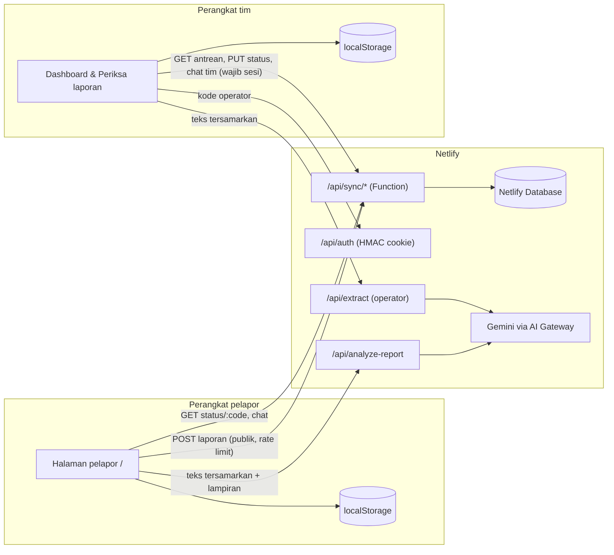
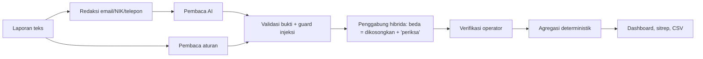

# POSKOTANGGAP

Alat posko bencana yang mengubah laporan warga berbentuk teks bebas menjadi **data kebutuhan yang diverifikasi manusia**, lalu membandingkannya dengan stok untuk menunjukkan apa yang paling butuh perhatian sekarang.

- **Tim:** Monotropa
- **Anggota:** Marquis Verino | Timothea Owen | Christiano Orlando Ruslie | Nicholas Brandon Santoso
- **Lomba:** LOGICODIX 2026 · Kategori **Web** · Subtema **Civic Tech & Community Service**

> Prototipe dengan data simulasi. Bukan layanan darurat; dalam keadaan darurat hubungi 112.

## Masalah dan pengguna
Saat bencana, kebutuhan datang dari banyak pelapor dengan teks tidak seragam: jumlah dan satuan sering hilang, laporan ganda, dan bahasa daerah. Operator posko harus merapikannya sebelum bisa mencocokkan dengan stok.

- **Pengguna:** (1) warga/relawan pelapor di lapangan, lewat HP; (2) operator posko, lewat laptop.
- **Bukti masalah:** [ISI: lihat `docs/PROBLEM_EVIDENCE.md` setelah diisi tim dengan sumber nyata]

## Fitur yang berjalan
**Pelapor (`/`)**
- Kirim laporan teks (boleh bahasa daerah), foto/video/berkas, dan titik GPS opsional. Foto digambar ulang di browser sehingga EXIF/GPS dibuang.
- Kode laporan 8 karakter; halaman status (`/status/:code`) menampilkan tahap diterima → diverifikasi → bantuan diatur, plus chat dua arah dengan tim.
- Saran AI (ringkasan, terjemahan, kewajaran) tampil sebagai saran; tombol telepon 112 dan rekomendasi Damkar/Ambulans dari kata kunci (kode, bukan AI).
- Kartu “Coba dalam 3 langkah” untuk orientasi.

**Tim (`/dashboard`, `/intake`), di balik kode operator**
- Antrean laporan masuk yang tersinkron dari perangkat pelapor (polling 15 detik).
- Pemeriksaan laporan: ekstraksi hibrida (aturan + AI) sebagai **draf**, tiap nilai disertai kutipan bukti; operator memverifikasi, menolak, atau menandai bantuan diatur.
- Deteksi potensi duplikat (tidak pernah dihapus/digabung otomatis; keputusan di operator).
- Dashboard: perhatian (KRITIS → PERINGATAN → INFORMASI), kebutuhan vs stok, satuan tidak cocok, kebutuhan tanpa jumlah pasti.
- **Salin sitrep** dan **Unduh CSV** (deterministik, tanpa AI; sel CSV berawalan `= + - @` dinetralkan).
- Penjaga injeksi perintah pada isi laporan (`lib/domain/injection.ts`).
- `/demo`: skenario presentasi dua layar (HP + laptop) yang menekan tombol yang sama dengan manusia.

**Aturan inti:** hanya laporan `verified` + kebutuhan `verified` + basis “additional” yang dijumlahkan; data tidak diketahui tetap `null`; tidak ada konversi satuan; AI tidak pernah masuk hitungan; status selalu ikon + teks.

## Teknologi
Vite + React 19 + TypeScript, React Router, Tailwind CSS 4, Zod, Vitest · Netlify (hosting, Functions, Netlify Database/Postgres via Drizzle ORM, AI Gateway) · Google Gemini lewat `@google/genai`.

## Arsitektur dan alur data



Penyimpanan tim ada di localStorage browser tim; server (Netlify Database) hanya menjadi jalur sinkron laporan, status, dan chat antar perangkat. Detail: `AGENTS.md`.

## Instalasi dan konfigurasi
```bash
npm ci
npm run dev        # Vite :5173 + API lokal :8788. Gerbang operator NONAKTIF di mode ini (ada peringatan di terminal)
npm run typecheck
npm test
npm run build
npm run eval       # evaluasi ekstraksi; AI hanya dijalankan bila ada kredensial (tambahkan --no-ai untuk aturan saja; menimpa docs/EVAL.md)
```
Sinkron lintas perangkat butuh Netlify (Functions + Database), mis. `netlify dev`. `npm run dev` tidak menyajikan `/api/sync/*`.

### Variabel lingkungan
| Nama | Wajib | Fungsi |
|---|---|---|
| `OPERATOR_PASSCODE` | Ya (produksi) | Kode masuk halaman tim. Kosong = halaman/endpoint tim tertutup. |
| `SESSION_SECRET` | Ya (produksi) | Kunci HMAC cookie sesi, minimal 16 karakter acak. |
| `GEMINI_API_KEY` | Tidak | Kunci Gemini sendiri; di Netlify, AI Gateway menyuntikkan kredensial otomatis. |
| `GEMINI_MODEL` | Tidak | Mengganti model (bawaan `gemini-3.5-flash`). |

Lihat `.env.example`. Jangan commit `.env`.

## Akun demonstrasi
Kode operator demo = 264982

Halaman tim dan `/demo` meminta kode ini (kode demo untuk juri, bukan akun nyata). Alur dua perangkat: buka `/` di HP untuk mengirim laporan, buka `/dashboard` di laptop, masukkan kode, laporan muncul di antrean.

## Dokumentasi AI
Lihat `docs/AI_USAGE.md` (titik pemakaian, data yang dikirim, redaksi, batas) dan `docs/EVAL.md` (evaluasi 46 kasus fiktif; label dibuat tim sendiri, bukan pihak independen).

## Pengujian
Hasil nyata ada di `docs/TEST_REPORT.md`. CI: `.github/workflows/ci.yml` (npm ci, typecheck, test, build).

## Batasan
- Data tim di satu browser; katalog barang kecil; ekstraksi aturan terbatas pada kata kunci.
- Rate limit bersifat best-effort per instance fungsi.
- Lampiran tidak diredaksi sebelum dikirim ke AI; PDF tidak dibersihkan metadatanya.
- Kode operator tunggal bersama (cukup untuk demo, bukan manajemen akun).

## Atribusi
Font DM Sans (`@fontsource/dm-sans`, SIL OFL). Pustaka sumber terbuka sesuai `package.json`. Model Gemini © Google. Lisensi kode: `LICENSE`. Semua data contoh fiktif. [ISI: atribusi lain, mis. peta/ikon/gambar bila ada]

## Dokumen lain
`DEMO_GUIDE.md` (skrip demo), `SUBMISSION_CHECKLIST.md`, `docs/archive/` (dokumen lama, digantikan).
